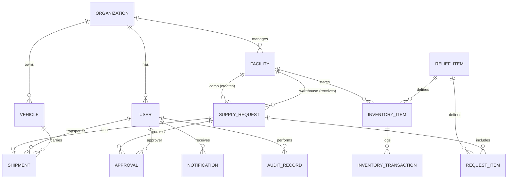

# Data Storage Design — IPFS Content-Addressed Store
**Blockchain-Based Disaster Relief Inventory Tracker**

This document describes how the application stores data using a **decentralized, content-addressed IPFS store** (Kubo). PostgreSQL has been **completely removed**; IPFS is the authoritative operational data layer. Ethereum is strictly reserved for the immutable verification of critical supply-chain events.

---

## 1. Architectural Principles & Blockchain Boundary

### IPFS ↔ Ethereum Boundary
- **IPFS** is the authoritative store for all operational application data: users, organizations, facilities, inventory, supply requests, approvals, shipments, vehicles, notifications, ML results, and the application audit trail. Every record is a JSON document stored by its content-address (CID).
- **Ethereum** is used only for the immutable verification of critical workflow events via the single `DisasterReliefAudit` contract. Passwords, notifications, item-level quantities and internal logistics never reach the blockchain.

### Content-Addressing & Index Documents
Each entity type is an independent "collection". The store maintains a small index layer in MFS (Mutable File System) so records remain mutable while the underlying documents are immutable:

```
/disaster-relief                          (MFS root)
  index.json                              → { "<collection>": "<collectionIndexCid>" }
  users/index.json                        → { "<userId>": "<userDocCid>" }
  organizations/index.json                → { "<orgId>": "<orgDocCid>" }
  facilities/index.json                   → { "<facilityId>": "<facilityDocCid>" }
  reliefItems/index.json                  → { "<itemId>": "<itemDocCid>" }
  inventoryItems/index.json               → { "<inventoryId>": "<inventoryDocCid>" }
  supplyRequests/index.json               → { "<requestId>": "<requestDocCid>" }
  ...
```

- **Write path:** serialize JSON → `add` + `pin` → new CID → update the collection index (`files/write` multipart) → update root index CID.
- **Read path:** read root index → collection index → individual document CID → JSON.
- **Immutability guarantee:** each revision is a new CID; the index always points to the latest revision. This preserves a complete, verifiable history of every document.

### Blockchain Transaction Hashes as References
A transaction hash (`txHashCreate`, `txHashReceipt`, `txHashDispatch`) stored on IPFS is **only a reference** to an Ethereum transaction. It is NOT treated as proof because the frontend supplied it; the Spring Boot backend must independently verify the transaction against the blockchain before trusting it.

### ML Classification Separation
`mlClassification` (`NORMAL` | `ABNORMAL`) and `mlConfidence` are analytical decision support stored on IPFS. They are NOT Ethereum workflow state and do not drive workflow transitions.

### Canonical Workflow Status
`SupplyRequest.status` is the single source of truth for the whole supply chain workflow. `Shipment` has no status field of its own; any shipment status shown in the UI is derived from the linked `SupplyRequest`.

---

## 2. Entity Relationship Overview



> Relationships are logical (UUID references inside JSON documents), not database foreign keys — referential integrity is enforced by the Spring Boot service layer.

---

## 3. Data Ownership & Grouping

| Group | Collections |
|---|---|
| Organization Management | `organizations`, `facilities` |
| Inventory Management | `reliefItems`, `inventoryItems`, `inventoryTransactions` |
| Supply Chain | `supplyRequests` (embeds `RequestItem`), `approvals`, `shipments` |
| Logistics | `vehicles` |
| Authentication | `users` (role embedded as enum) |
| Notification | `notifications` |
| Application Audit | `auditRecords` |

---

## 4. Entity Specifications (JSON Documents)

Every document carries `id` (UUID) and `cid` (IPFS content identifier of its own latest revision).

### 4.1 User
- `id`, `email`, `passwordHash` (BCrypt — never stored on-chain), `role` (enum `GOVERNMENT_ADMIN | WAREHOUSE_MANAGER | CAMP_MANAGER | NGO_COORDINATOR | TRANSPORT_OFFICER`), `walletAddress` (nullable, links to MetaMask), `fullName`, `enabled`, `createdAt`, `updatedAt`, `cid`.

### 4.2 Organization
- `id`, `name`, `type` (`GOVT | NGO`), `contactInfo`, `createdAt`, `updatedAt`, `cid`.

### 4.3 Facility
Normalized single entity representing both Warehouses and Camps.
- `id`, `organizationId`, `name`, `type` (`WAREHOUSE | CAMP`), `location`, `managerUserId`, `population` (CAMP), `maxCapacity` (CAMP), `capacitySqm` (WAREHOUSE), `createdAt`, `updatedAt`, `cid`.

### 4.4 ReliefItem
Master dictionary of relief supplies.
- `id`, `name`, `category` (`FOOD | MEDICINE | WATER | EQUIPMENT | SHELTER | CLOTHING | OTHER`), `unit`, `description`, `createdAt`, `updatedAt`, `cid`.

### 4.5 InventoryItem
- `id`, `facilityId`, `reliefItemId`, `quantity`, `reservedQuantity`, `updatedAt`, `cid`.
- Invariants enforced by service: `quantity >= 0`, `reservedQuantity >= 0`, `quantity >= reservedQuantity`.

### 4.6 InventoryTransaction
- `id`, `facilityId`, `reliefItemId`, `type` (`ADD | SUBTRACT | RESERVE | RELEASE`), `quantity`, `userId`, `createdAt`, `cid`.

### 4.7 SupplyRequest
The canonical workflow entity.
- `id`, `campId`, `warehouseId`, `status` (`NONE | CREATED | APPROVED | ACCEPTED | DISPATCHED | IN_TRANSIT | ARRIVED | RECEIVED | COMPLETED | REJECTED`), `mlClassification`, `mlConfidence`, `txHashCreate`, `txHashReceipt` (untrusted refs), `items[]` (embedded `RequestItem`), `createdBy`, `createdAt`, `updatedAt`, `cid`.

### 4.8 RequestItem (embedded)
- `reliefItemId`, `itemName`, `itemCategory`, `requestedQty`, `fulfilledQty`.

### 4.9 Approval
- `id`, `supplyRequestId`, `approverUserId`, `status` (`APPROVED | REJECTED`), `comments`, `txHash` (untrusted ref), `createdAt`, `cid`.

### 4.10 Shipment
- `id`, `supplyRequestId` (1:1), `transporterUserId`, `vehicleId`, `dispatchTime`, `arrivalTime`, `txHashDispatch` (untrusted ref), `cid`. Status intentionally omitted — derived from `SupplyRequest.status`.

### 4.11 Vehicle
- `id`, `organizationId`, `registrationNumber`, `vehicleType`, `capacityKg`, `active`, `cid`.

### 4.12 Notification
- `id`, `userId`, `message`, `read`, `createdAt`, `cid`.

### 4.13 AuditRecord
Internal off-chain audit log for application events.
- `id`, `action`, `actorUserId`, `entityType`, `entityId`, `details`, `txHash`, `createdAt`, `cid`.

---

## 5. Storage & API Configuration

| Setting | Value |
|---|---|
| Kubo API | `http://127.0.0.1:5001/api/v0` |
| Kubo Gateway | `http://127.0.0.1:8080` |
| MFS root | `/disaster-relief` |
| Index file name | `index.json` |

### Kubo API Behaviour (verified)
- `add` and `files/write` require **multipart** form bodies (`file` / `data` fields).
- `cat` and `files/read` require **POST** (GET returns 405).
- A missing MFS file returns HTTP 500 with body `file does not exist`.
- Browser-style `Origin` headers return 403; the Java HTTP client sends none and works.

---

## 6. Key Constraints & Integrity Rules

1. Password hashes are BCrypt-encoded and never leave IPFS/application storage.
2. Wallet addresses link application identity to Ethereum for on-chain role authorization; only the address is shared with the blockchain.
3. Transaction hashes are untrusted references until verified by `EthereumService` (Phase 6).
4. `SupplyRequest.status` transitions are enforced by the service layer exactly mirroring the smart contract's state machine.
5. Rejection is only allowed from `CREATED` and `APPROVED`.
6. Every document write produces a new CID and updates the index, preserving an immutable, verifiable revision history.
