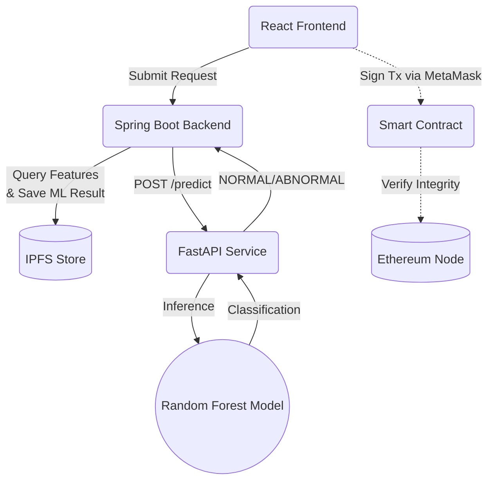

# Machine Learning Architecture Design
**Blockchain-Based Disaster Relief Inventory Tracker**

This document outlines the complete Machine Learning (ML) architecture for the project. It explicitly defines the boundaries between the ML service, the Spring Boot application orchestrator, and the Ethereum blockchain.

---

## 1. ML Purpose
*   **Why ML is used:** To provide automated, data-driven analysis of incoming supply requests based on historical patterns and camp parameters.
*   **Problem it solves:** In a disaster scenario, identifying unusually large or anomalous requests manually is time-consuming. The ML model quickly flags requests that deviate from normal patterns.
*   **Decision it supports:** The classification dictates workflow routing. It determines whether a request requires explicit **Government Review**.
*   **What ML does NOT control:** The ML model is purely a decision-support mechanism. It does **not** directly authorize, reject, or complete requests. It cannot modify blockchain state. 
*   **Return Values:** The model strictly returns `NORMAL` or `ABNORMAL`. This classification is **not** a blockchain `RequestStatus`.

## 2. ML Architecture
The ML architecture is a synchronous, microservice-based interaction heavily orchestrated by the backend:
1.  **React:** Submits the supply request form. It does **not** communicate directly with the ML service.
2.  **Spring Boot (Java):** The main application orchestrator. It receives the request, gathers required features from IPFS, and calls the Python ML service.
3.  **FastAPI (Python):** A stateless API wrapping the trained Random Forest model. It receives features, runs inference, and returns the classification.
4.  **Random Forest:** The trained scikit-learn model executing the mathematical classification.
5.  **IPFS:** Stores the final ML classification and confidence score alongside the operational `SupplyRequest` document.

## 3. ML Input Features
The Random Forest model will use features realistically obtainable from the IPFS store at the time of request creation.

| Feature Name | Data Type | Meaning | Source | Preprocessing |
| :--- | :--- | :--- | :--- | :--- |
| `requested_qty` | Float | The amount of the item requested. | Supply Request Form | Scaling (optional for RF) |
| `item_category` | String | Category of the relief item (Food, Medicine). | `ReliefItem` document | One-Hot Encoding |
| `camp_population` | Integer | Current number of refugees in the camp. | `Facility` document | None |
| `camp_capacity` | Integer | Maximum capacity of the camp. | `Facility` document | None |
| `current_inventory` | Float | Amount of the item currently at the camp. | `InventoryItem` document | None |
| `historical_freq` | Integer | Number of times this camp requested this item in 30 days. | IPFS store aggregation | None |

## 4. Target Variable
*   **Prediction Target:** The model predicts whether the supply request is an anomaly.
*   **Target Labels:** `classification = NORMAL | ABNORMAL`.
*   **Training Representation:** In the dataset, this will be represented as a binary label (e.g., `0` for NORMAL, `1` for ABNORMAL). 
*   **Strict Constraint:** This target variable is an analytical metric; it is **not** a blockchain `RequestStatus`.

## 5. Dataset Design
Since this is a new system without real historical data, a **synthetic/academic dataset** will be generated for the prototype to mimic disaster-relief supply patterns.

*   **Columns:** `requested_qty`, `item_category`, `camp_population`, `camp_capacity`, `current_inventory`, `historical_freq`, `is_abnormal`.
*   **Data Types:** Numeric (Int/Float) and Categorical (String).
*   **Target Column:** `is_abnormal` (Integer: 0 or 1).
*   **Preprocessing:** 
    *   Missing values: Filled with medians or mode.
    *   Categorical Encoding: `item_category` will be one-hot encoded.
*   **Example Row:** `[500, 'Food', 2000, 2500, 50, 2, 0]` -> (NORMAL)

## 6. Random Forest Model
*   **Why Random Forest?** It is highly suitable for this academic project because it handles tabular data exceptionally well, is robust against overfitting, requires minimal hyperparameter tuning, and provides high interpretability (Feature Importance).
*   **Classification Approach:** Supervised binary classification.
*   **Training/Validation/Testing:** Standard 70/15/15 split of the synthetic dataset.
*   **Hyperparameters:** `n_estimators` (number of trees), `max_depth` (tree depth).
*   **Class Imbalance:** If `ABNORMAL` cases are rare in the synthetic data, we will use SMOTE or `class_weight='balanced'`.

## 7. ML Output
The conceptual JSON response from the ML API:
```json
{
  "classification": "ABNORMAL",
  "confidence": 0.89
}
```
*   **Confidence Meaning:** The probability assigned by the Random Forest model (e.g., 89% of the trees in the forest voted for ABNORMAL).
*   **Constraint:** The ML service returns this JSON. It does **not** directly write to IPFS.

## 8. FastAPI Service Design
*   **Endpoint:** `POST /predict`
*   **Request Fields:** A JSON payload containing the 6 input features defined in Section 3.
*   **Response Fields:** `classification`, `confidence`.
*   **Validation:** FastAPI Pydantic models will validate that all required fields are present and are of the correct data type.
*   **Error Handling:** Returns `400 Bad Request` for invalid input, `500 Internal Server Error` if inference fails.
*   **Responsibility:** Perform inference ONLY.

## 9. Spring Boot Integration Flow
1.  User creates a `SupplyRequest` in React.
2.  Spring Boot receives and validates the request.
3.  Spring Boot queries IPFS to gather the 6 required ML features (e.g., current camp population, inventory).
4.  Spring Boot calls FastAPI `POST /predict` synchronously.
5.  FastAPI performs Random Forest inference.
6.  FastAPI returns the classification and confidence to Spring Boot.
7.  Spring Boot stores the `SupplyRequest` on IPFS with the ML results.
8.  Spring Boot applies the business rule:
    *   `NORMAL` -> Request status becomes `APPROVED` (or continues according to standard rules).
    *   `ABNORMAL` -> Request status becomes `CREATED` and flagged for Government Review.
9.  **Note:** ML does not directly approve, reject, or modify blockchain state.

## 10. ML and Blockchain Boundary
**OFF-CHAIN (IPFS / Filesystem):**
*   Training data (`.csv`)
*   Trained model (`.pkl` / `.joblib`)
*   ML predictions, classifications (`NORMAL`/`ABNORMAL`), and confidence scores.
*   Raw feature data.

**ON-CHAIN (Ethereum):**
*   **Nothing** from the ML model itself.

*   **Why?** Machine learning inferences are probabilistic analytical data, not critical state transitions. Storing strings like "NORMAL" or float probabilities on Ethereum is a massive waste of gas and violates the separation of concerns (IPFS handles operations; Ethereum handles critical workflow integrity).

## 11. ML Security Boundaries
*   **Network Constraint:** React cannot directly call FastAPI.
*   **Storage Constraint:** FastAPI cannot directly modify IPFS.
*   **Orchestration:** Spring Boot tightly controls all ML requests.
*   **Decision Support:** ML output is treated as untrusted decision-support data. It cannot bypass application authorization (Spring Security) or smart-contract state-machine rules.

## 12. Failure Handling
*   **FastAPI / Model Unavailable:** Spring Boot catches the connection timeout/error.
*   **Prediction Fails / Invalid Input:** FastAPI returns an error, caught by Spring Boot.
*   **Fallback Strategy:** Do **not** silently approve or reject. If the ML service is down, Spring Boot will default the classification to `ABNORMAL` with `confidence = 0.0`. This ensures safety by forcing a manual Government Review rather than accidentally auto-approving a potentially dangerous request.

## 13. Deployment Architecture
*   **Local Development Structure:**
    *   `frontend/` (React running on port 5173)
    *   `backend/` (Spring Boot running on port 8081)
    *   `ml/` (FastAPI running on port 8000)
    *   `blockchain/` (Hardhat node running on port 8545)
    *   `ipfs/` (Kubo daemon: API 5001, gateway 8080)
*   **Communication:** React (5173) -> HTTP -> Spring Boot (8081) -> HTTP -> FastAPI (8000).
*   **No Unnecessary Tech:** No Docker, K8s, or cloud ML platforms are introduced for this local academic architecture.

## 14. ML Development Lifecycle (Future Implementation)
1.  Prepare synthetic dataset.
2.  Preprocess data.
3.  Split dataset.
4.  Train Random Forest.
5.  Evaluate model.
6.  Save trained model (Joblib/Pickle).
7.  Build FastAPI service.
8.  Integrate FastAPI with Spring Boot via REST.
9.  Store predictions on IPFS.
10. Test end-to-end workflow.

## 15. Final Architecture Diagram


*Note: The blockchain flow is distinct and isolated from the ML inference loop.*

## 16. Final Design Rules
*   ML is purely **decision support**.
*   ML is completely **off-chain**.
*   ML classification is **not** a blockchain state.
*   **Spring Boot** is the strict ML orchestrator.
*   **FastAPI** only performs ML inference.
*   FastAPI **cannot** directly modify IPFS.
*   React does **not** directly call FastAPI.
*   ML **cannot** bypass application authorization.
*   ML **cannot** bypass smart-contract authorization or state transitions.
*   **No unnecessary ML infrastructure** (cloud, Docker, etc.) should be introduced for local development.
